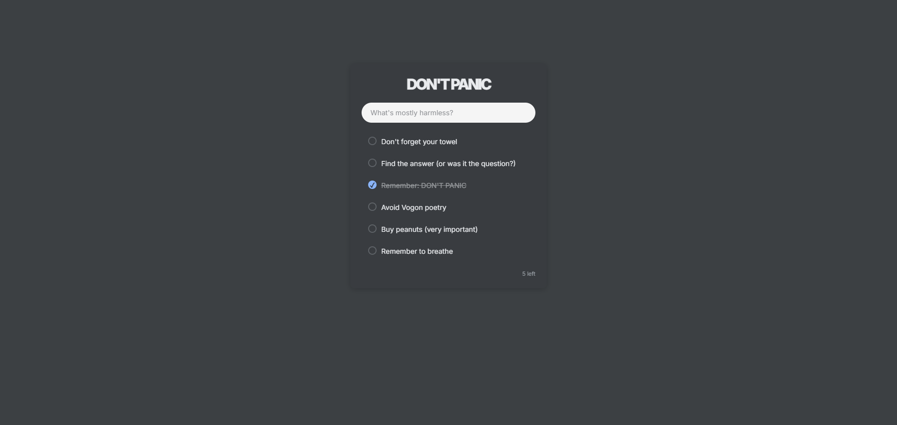

# DON'TPANIC

> *Anything that happens, happens.*
> 
> 
> *Anything that, in happening, causes something else to happen, causes something else to happen.*
> 
> 
> *Anything that, in happening, causes itself to happen again, happens again.*
> 
> 
> *It doesn't necessarily do it in chronological order, though.*
> 
> — Douglas Adams, *Mostly Harmless*

A minimal todo list Chrome extension that replaces your new tab.



## Features

- **Minimal & Clean** - Distraction-free interface with a calm, modern design
- **Persistent Storage** - Your todos survive browser restarts

## Installation

Clone or download this repository, then:

1. Open Chrome and navigate to `chrome://extensions/`
2. Enable **Developer mode** (toggle in top-right corner)
3. Click **Load unpacked**
4. Select the extension folder
5. Done! Open a new tab to see DON'TPANIC

## Design Philosophy

The only design principle here: **it should feel native**. DON'TPANIC adapts to your Chrome's aesthetic, blending seamlessly as if it were built into the browser itself.

## Tech Stack

- Vanilla JavaScript (no frameworks)
- Chrome Extension Manifest V3
- Chrome Storage API for persistence
- Inter font for clean typography

## File Structure

```
dontpanic-extension/
├── manifest.json      # Extension configuration
├── newtab.html       # Main UI structure
├── styles.css        # All styling
├── newtab.js         # Todo logic and storage
├── icon.png          # Extension icon (optional)
└── README.md         # This file
```

## Future Ideas

- [ ] Chrome theme color detection
- [ ] Dark/light mode auto-detection
- [ ] Export/import todos
- [ ] Due dates
- [ ] Support links

## Privacy

- All data stored locally in your browser
- No analytics, tracking, or external requests
- No data leaves your machine
- No permissions beyond storage

## Contributing

This is a personal project, but feel free to fork and make it your own! If you have suggestions, open an issue or submit a PR.

## License

MIT License - Feel free to use, modify, and distribute.

## Acknowledgments

Inspired by *The Hitchhiker's Guide to the Galaxy* series by Douglas Adams.

---

**Remember:** Don't panic. One thing at a time.